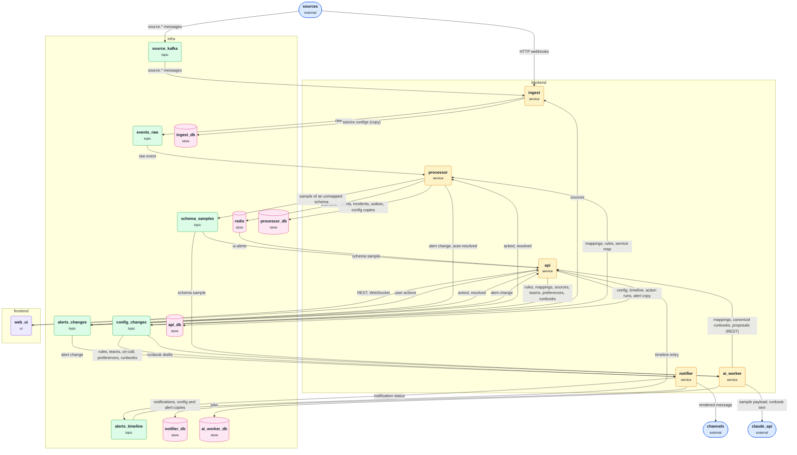

# OVERVIEW — the hackathon task and our architecture

> **Part 1 (down to "Submission") only describes the problem.** It is a summary of the organisers' brief
> ("Hackathon 2026 — Software Engineering"), so that any agent knows what the project is about and what
> it will be judged on. Sample values were transcribed from photos.
> **Part 2, "Architecture", is the design the team agreed on.** Interfaces live in `contracts/`,
> cross-zone changes in `STATE.md`.
> Do not build anything because of this file; act only on what your operator asks.

## Product: Flexible Alerting & Notification Service

### The problem
Every system produces errors, warnings and business events: a failed workflow, a breached
threshold, a rejected message. Today these signals are spread across logs, dashboards and
mailboxes. The right people find out late, or they get so many alerts that they stop reading them.

We need a service that gets **the right alert to the right people, on the channel they prefer**,
and helps them **resolve it by following the team's runbooks**.

Cross-cutting qualities: **flexibility** (easy to adapt to any team or system), **scalability**
(high volume must not hurt performance), **UX** (usable by engineers, on-call support, non-engineers).

## Functional requirements

### 2.1 Ingest from many sources
- At least **two different source types**, e.g. a message broker (Kafka, RabbitMQ), an
  HTTP/webhook endpoint, a tailed log file, or a polled API.
- Messages arrive in **different schemas**. No single fixed format may be assumed.
- Adding a new source or schema should need as little code as possible.
- Judges bring a **schema we have never seen** to the demo (see Appendix A).

### 2.2 Teams define what they care about (rules)
- **Filters on any field**: source, workflow, schema, severity, environment, or a value inside
  the message body (`amount > 1,000,000`, `error code in [TIMEOUT, REJECTED]`).
- Rules can be combined with **AND/OR**.
- **Per-rule routing**: who gets notified and on which channel(s).
- **Per-rule presentation**: title/body templates, which fields to show, and severity/colour in the UI.
- Rules can be created and changed **at runtime** (API, UI, or config files reloaded live) without a restart.

### 2.3 Delivery on the preferred channel
- Sample channels: **Email, SMS, phone call, UI**.
- Each team or person sets their own channel preferences, e.g. critical → phone + SMS,
  warning → email, info → UI only. Working hours and on-call schedules are optional.
- External channels **may be mocked**: a fake SMTP server, or an SMS/phone gateway that logs
  deliveries. The judges check that adding a real provider would be a small, isolated change.
- **Delivery must survive failure**: retries, and no lost alerts when a channel is down.

### 2.4 Service UI
- A live feed of a team's alerts, updated in real time (push, not page refresh).
- Acknowledge or resolve an alert.
- Manage rules and channel preferences.
- Propose fixes or enhancements to alerts.
- How an alert looks is controlled by its rule (2.2).

### 2.5 Don't flood people
- **Deduplication**: the same error 500 times a minute is one alert with a counter, not 500 alerts.
- **Throttling or grouping** per rule or per recipient.

### 2.6 Help resolve alerts with runbooks
An alert should say what to do next, not only what went wrong.
- Teams attach runbooks to rules, schemas or alert types. Runbooks come in several formats:
  a Markdown page, a wiki/Confluence link, a checklist, or free text written by a person (Appendix B).
- When an alert fires, the matching runbook is shown, with values from the message filled in
  (workflow ID, service name), on every channel where it fits: full steps in the UI and email,
  a short link in an SMS.
- Steps can be **actions**, not only text: retry a workflow, restart a service, call a webhook,
  open a ticket, escalate to another team.
- **Risky actions need human approval** first (from the UI, or by replying to the alert).
- Record what was done and by whom. Close the alert when the problem goes away.
- Adding a new runbook or a new kind of action should be as easy as adding a rule.
- Optional: record the steps taken during incidents automatically, so the runbook or
  knowledge base updates itself.

## Example rules (from the brief, in plain words)
- **Team Settlements**: any `WORKFLOW_FAILED` where workflowName = order-settlement and
  environment = prod → phone the on-call person + SMS; show the step and error message in red in the UI.
- **Team Pricing**: log lines from `pricing-engine*` at error level or above → UI only; group them
  into one alert per instrument every 5 minutes.
- **Team Rates**: `trade.rejected*` where desk = rates and notional > 10,000,000 → email + UI,
  with a templated title built from payload fields.
- **Anna (a person)**: anything critical from payments-api → SMS, but only 08:00–20:00; otherwise email.

## Appendix A: sample events (three different envelopes)
Workflow failure (message broker):
```json
{"type": "WORKFLOW_FAILED", "workflowId": "WF-2026...", "workflowName": "order-settlement",
 "step": "...", "severity": "critical", "environment": "prod", "timestamp": "2026-...",
 "error": {"code": "TIMEOUT", "message": "Counterparty service did not respond in 5000 ms"}}
```
Metric threshold breach (HTTP webhook, Alertmanager-like):
```json
{"alertname": "HighErrorRate",
 "labels": {"service": "payments-api", "region": "eu-west", "severity": "critical"},
 "annotations": {"summary": "Error rate 12% over the last 5 minutes"},
 "startsAt": "2026-...", "status": "firing"}
```
Business event (message broker, different envelope):
```json
{"meta": {"schema": "trade.rejected.v1", "producer": "trade-gateway", "ts": 1782...},
 "payload": {"tradeId": "T-...", "desk": "rates", "notional": 25000000,
             "currency": "EUR", "reason": "LIMIT_BREACH"}}
```

## Appendix B: sample runbooks (three shapes; judges bring a fourth)
Structured steps (YAML, Team Settlements):
```yaml
runbook: settlement-timeout
matches: {type: WORKFLOW_FAILED, "error.code": TIMEOUT}
steps:
  - check: "Is counterparty-service healthy?"
    action: http_get
    url: "http://counterparty-service/health"
  - action: retry_workflow
    workflowId: "{{workflowId}}"
    approval: none
  - if: "retry fails twice"
    action: escalate
    team: counterparty-support
    approval: required
```
Markdown page (payments rule):
```
# HighErrorRate on payments-api
1. Open the payments dashboard and check if errors are in one region only.
2. If one region: fail traffic over to the other region (needs approval from the team lead).
3. If all regions: check the last deployment and roll it back.
4. Post an update in the #payments-incidents channel every 15 minutes.
```
Free text (from a wiki or chat):
> When pricing latency goes over a second, it's usually the cache. Restart the pricing-engine
> instance named in the alert, wait 2 minutes, and if latency is still high, call the pricing on-call person.

## How it is judged
- **Flexibility**: how easy is it to add a new source, schema, channel or rule type? Is it config
  or code? How expressive are the rules?
- **Scalability**: can it scale horizontally? How is state handled (rules, dedup windows,
  delivery status)? Is there an obvious bottleneck or single point of failure?
- **UX**: can someone who has never seen the UI use it? Is the rule editor understandable?
  Are alerts clear and actionable? How many commands and how long from a fresh clone to a
  working demo? Is the README clear? How long until a new team starts getting alerts?
- **Throughput/latency**: messages per second ingested and processed, and end-to-end latency
  from ingest to delivery (p50/p99). **Measured, not estimated.** The load-test script and its
  results go into the presentation.
- **Level of implementation**: a repo link with a clear README that says what is mocked.
- **Innovation**, and the **presentation**.

## Submission
- A **video of up to 5 minutes** that explains and demonstrates the solution. It is the
  **primary basis for judging** in every category.
- If AI tools were used (Copilot, Claude), say how, and how security and privacy concerns were handled.
- Upload to Lockbox in a directory named after the team. Recommended: also a text file with
  links to the Git repo and/or a demo app.
- After the first round, the top five teams present live in the final, followed by Q&A.

---

## Architecture

Agreed on 20-11. Five services (Ingest, Processor, Notifier, API and an off-path AI worker) on one shared
internal Kafka cluster and Redis, each with its own Postgres database. No Claude call is made per event. Alerts are stored, deduplicated after rule match,
and delivered through a policy layer with retries. Each service's code lives in `backend/<service>/`.
Interfaces: [contracts/](contracts/services.md); each database's tables: `contracts/schemas/<service>.md`.
Machine-readable map: `docs/architecture/map.jsonl`.
Nothing is built or measured yet.

### At a glance

<!-- arch:diagram -->

<!-- /arch:diagram -->

Events run Sources (webhooks or the sources Kafka cluster) → Ingest → `events.raw` → Processor → `alerts.changes` → Notifier → channels.
No service reads another service's database: the API, UI and AI worker reach the event path only
through Kafka topics and Redis.

### Services

Every service is stateless; all state sits in Kafka, Redis or the service's own Postgres, so each one runs in two or more replicas.

| Service | Does | State it uses | Scales by |
|---|---|---|---|
| Ingest (`backend/ingest`) | Source adapters (HTTP webhook, Kafka `source.*` topics on a separate sources cluster). Stamps `event_id`, `source_id`, `received_at` and writes the raw payload to `events.raw`. No other logic. | Its copy of the source configs (`ingest` database) | Replicas behind a load balancer |
| Processor (`backend/processor`) | Applies the stored schema mapping, or marks the event unmapped. Evaluates rules. Deduplicates and groups per rule. Links related alerts into incidents. Owns alert state: writes it, publishes state changes to `alerts.changes`, applies acks and resolves from the API, and auto-resolves an alert when nothing recurs for the rule's window. | Alerts, incidents and an outbox, plus its copies of mappings, rules and the service map compiled into memory (`processor` database); counters (Redis) | Kafka partitions of `events.raw` |
| Notifier (`backend/notifier`) | Policy: who is told, when, on which channel, in one message or a digest. Writes notification rows with a send time. Workers send through channel adapters with retry, backoff and a fallback channel. A scheduler loop runs escalation steps and digests. Reports every delivery on `alerts.timeline`. | Notification outbox, plus its copies of rules, teams, on-call, preferences, runbooks and alert state (`notifier` database) | Workers claiming rows with `SKIP LOCKED` |
| API (`backend/api`) | REST and WebSocket for the UI: live feed, ack and resolve, rules, mappings, preferences, runbooks, approvals, improvement proposals. Hosts the runbook module: lookup, placeholder fill, and the action runner with its approval gate. | Owns all configuration (published on `config.changes`), runbooks, the timeline, action runs and proposals; keeps a read copy of alerts and deliveries (`api` database); pushes via Redis pub/sub | Replicas; any replica can push to any browser |
| AI worker (`backend/ai-worker`) | Off the event path. Proposes a mapping for a new schema, converts an uploaded runbook to the canonical form, and drafts runbook updates from action logs. Sends its results to the API over REST. | Its job queue (`ai_worker` database) | One or two workers with a concurrency cap |

Shared infrastructure: one internal Kafka cluster used by all backend services, with five topics
(`events.raw` and `alerts.changes` on the event path; `config.changes`, `alerts.timeline` and `schema.samples`
beside it), a separate sources Kafka cluster that third-party systems publish to and only Ingest reads, and
Redis. Not shared: every service has its own Postgres. Mocks: MailHog for email, a logging gateway for SMS and calls, and a small target service that
runbook actions call.

### Data ownership: one Postgres per service

| Service | Database | Owns | Keeps a copy of (fed by) |
|---|---|---|---|
| Ingest | `ingest` | nothing | Sources (`config.changes`) |
| Processor | `processor` | Alerts, incidents, its outbox, the schemas already reported, parked unmapped events | Mappings, rules, service map (`config.changes`) |
| Notifier | `notifier` | Notifications (delivery outbox) | Alerts (`alerts.changes`); rules, teams, users, on-call, preferences, runbooks (`config.changes`) |
| API | `api` | Sources, mappings, rules, teams, users, on-call, preferences, service map, runbooks, timeline, action runs, proposals | Alerts (`alerts.changes`), deliveries (`alerts.timeline`), schema samples (`schema.samples`) |
| AI worker | `ai_worker` | Its job queue | nothing |

- A table has one owner, and only that service connects to the database it lives in.
- Data crosses services only as Kafka records on the shared cluster, or through the API's REST endpoints
  (the AI worker's results). A service that needs another's data keeps its own copy, fed by the topic.
- A copy may name and type things differently from the owner's table, so any work on an exchange between
  two services starts from both schema files: `contracts/schemas/<service>.md`.
- A schema change or migration updates the database and that file in the same PR ([AGENTS.md](AGENTS.md)).

### How one event flows

1. A source sends an event. Ingest stamps `event_id`, `source_id` and `received_at`, writes the raw payload
   to `events.raw`, and acknowledges the source only after Kafka confirms.
2. A Processor replica reads it and finds the mapping whose `match` condition fits. It builds the envelope
   `{source, type, severity, env, service, ts, dedup_hints, raw}`. With no mapping it builds an unmapped
   envelope with defaults, publishes one sample of that schema to `schema.samples` for the AI worker, and
   parks the event; when the mapping arrives, parked events run again as mapped ones.
3. It evaluates every team's rules against the envelope and `raw`. Each matching rule yields an alert key
   from that rule's `alert_key` and window settings.
4. For each key, one atomic Redis operation bumps the alert's counter and `last_seen`, skipping an event
   Kafka delivered twice. When Redis does not know the key, the Processor's database decides: a unique
   index allows one live alert per key.
5. A new alert is written to the Processor's database together with its change record (an outbox row in
   the same transaction) and joined to an open incident when an upstream service in the `depends_on` map
   already has one. Counter bumps are flushed in batches.
6. State changes (new, severity up, reopened, resolved) go from the outbox to `alerts.changes` for the
   Notifier and the API, and to Redis pub/sub, from which the API pushes them to open browsers.
7. Notifier resolves recipients (rule routing, then team, then members or on-call, then personal
   preferences), keeps one message per person, and writes notification rows with a send time: now, the next
   escalation step, or the next digest.
8. A worker renders the message per channel, attaches the runbook with event values filled in, and sends
   it. Failures retry with backoff, then use the fallback channel. An ack cancels rows still pending.
   Each delivery is reported on `alerts.timeline`.
9. In the UI a person acks, runs a runbook action, or approves a risky one. The API publishes ack and
   resolve as alert changes too, and the Processor applies them to the alert. Every step is recorded on
   the alert timeline, which the API stores.

Latency is measured from `received_at` in step 1 to the send timestamp the mock channel logs in step 8.

### What changed from the first proposal

Seven services and five Kafka topics became five services and five internal topics: two on the event path,
three that carry configuration, the timeline and schema samples between databases. The last column names what
each change is needed for (AC = [docs/acceptance-criteria.md](docs/acceptance-criteria.md)).

| Area | Proposed | Final | Needed for |
|---|---|---|---|
| Normalization | Claude maps every payload | Claude writes a mapping once per schema; Processor applies it | AC-2.2, AC-9.2 |
| Unknown schema | No path when the LLM fails or is slow | Event shown as unmapped at once; mapping written in the background, then the waiting events are processed with it | AC-2.1 |
| Ingest | Preprocesses payloads; hand-off undecided | Receives, stamps, enqueues; acknowledges after Kafka confirms | AC-1.2, AC-9.2 |
| Dedup | Separate job before the Rule Engine | Step in Processor after rule match, keyed by the rule's settings | AC-4.1, AC-4.4 |
| Aggregation | Per routed bucket | Incidents correlated across teams with a `depends_on` service map | AC-4.2 |
| Routing | One Kafka topic per team or role | One topic; team and recipients are fields on the alert | AC-3.2, AC-5.3 |
| Alert state | Absent | Alerts and incidents in the Processor's database, the timeline in the API's; open, acked, resolved | AC-4.3, AC-7.3 |
| Notification policy | Absent | Policy step in Notifier: state-change triggers, escalation ladder, digest, rate limit, quiet hours | AC-5.3 to AC-5.6 |
| Delivery | Direct send | Outbox rows with idempotency key, retry, backoff, fallback channel | AC-6.2, AC-6.3 |
| Channels | SMTP, SMS, phone | UI added as a channel; message rendered per channel | AC-6.1, AC-8.1 |
| UI and API | Absent | API service with REST and WebSocket | AC-8.1 to AC-8.4 |
| Runbook Service | Pipeline stage after aggregation | Lookup at render time; conversion once on upload, confirmed by a person | AC-7.1 |
| Runbook storage | Blob plus Kafka, undecided | Rows in the API's database: original, canonical form, version, status | AC-9.1 |
| Runbook execution | Automatic, before notification, no human | Started from the UI after notification; approval required by default for anything that changes state | Brief 2.6, AC-7.3 |
| Step failure | Falls back to the LLM | Stops and escalates to a person; the LLM only suggests text | Brief 2.6 |
| Learned execution graphs | Reused automatically | Filed as a proposed runbook update the owner accepts or rejects | AC-8.4 |
| Actions | Execution graph, registry unspecified | Plugins: one file plus a config entry per action type | AC-7.4 |

### Open points resolved

| Question | Decision | Reason |
|---|---|---|
| Merge Ingest and Normalization? | No. Kafka stays between them; normalization moves into Processor | The buffer keeps events while processing is down |
| How does Ingest hand events over? | Kafka topic `events.raw` | Durable, replayable, and the unit of horizontal scale |
| Runbook storage | Postgres (the API's database) | Small records that need lookup by rule and type, and versions |
| Should the Runbook Service consume aggregation output? | No. Runbooks are looked up at render time | Notifications never wait on runbooks |
| Dedup and aggregation at two pipeline stages? | One stage, after rules, inside Processor | The dedup key is a rule setting; window state lives in one place |
| Who decides when and how often a person is notified? | The policy step in Notifier | Keeps what happened apart from who is disturbed |
| Where do alert state, the UI and the audit log live? | Alert state in the Processor's database; the API serves its read copy; the audit log is the alert timeline in the API's database | Each service owns its data; the feed, the timeline and delivery status are still served from one place |
| One database or one per service? | One Postgres per service on one shared internal Kafka cluster | Services cannot couple through tables, and each one deploys and scales alone |
| What triggers a normal notification, and where are recipients resolved? | An alert state change; resolved in Notifier at that moment | Counter bumps never notify; preferences and on-call are read fresh |

### Decisions on defaults (confirmed 20-11)

- Second source type: `source.*` topics on a separate Kafka cluster for third-party systems; Ingest is the
  only bridge to the internal cluster (changed later on 20-11, was: same cluster).
- Storage: one Postgres per service, one shared internal Kafka cluster (changed later on 20-11, was: one
  shared database). What follows from it: configuration travels on `config.changes`, deliveries on
  `alerts.timeline`, schema samples on `schema.samples`; the Processor, which owns alert state, auto-resolves
  alerts (was: Notifier); the AI worker saves its results through the API.
- New schema: a Claude-proposed mapping is applied automatically once it validates on the stored sample.
- Unmapped events: the processor parks them (up to 1,000 per schema, for 1 hour) and processes them as
  soon as a mapping for them is active (changed on 21-11, was: no replay).
- Rule language: a JSON tree of `{all / any: [{field, op, value}]}`, shared by rules, mapping `match` and
  runbook `matches` ([contracts/rules.md](contracts/rules.md)).
- Dedup and correlation windows: 5 minutes by default, per rule; an estimate, not measured.
- Defaults that stand until someone objects: teams, people and on-call are seeded tables with no login
  and a user picker in the UI; the load test reports ingest → alert visible and ingest → mock channel
  separately, with the duplicate ratio stated; Claude receives one truncated sample payload per new schema
  and runbook text on upload.
- AC-5.1, AC-5.2 and AC-7.2 are still TBD: the design supports them, the thresholds are not set.
