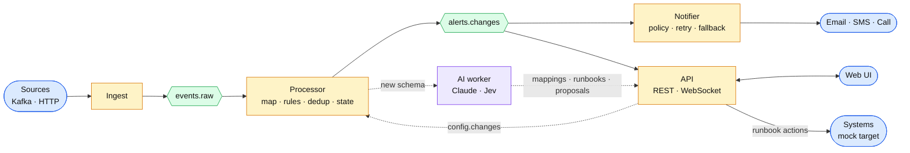

> **Presentation:** [presentation/alpin-deck.pdf](presentation/alpin-deck.pdf)

# Flexible Alerting & Notification Service


> [!NOTE]
> All numbers are from one Mac (Docker Desktop), with the load generator on the same machine, so throughput is capped
> by the generator, not the pipeline (no lag left in any run). Latency drops as instances are added: at the same
> 9k msg/s target, ingest → UI p99 fell from 463 ms to 249 ms with 3 processors and 3 notifiers. See [Measured](#measured).

Errors, metric alerts and business events from any system, in any format, become **one alert** for the people who
own the problem, on **the channel each of them prefers**, with **the team's runbook** filled in and runnable.

| | |
|---|---|
| **Any source, any schema** | Kafka and HTTP. A never-seen schema shows up at once; Claude writes its mapping in the background and the waiting events replay. |
| **Rules per team** | Any field, payload values included (`notional > 10000000`), AND/OR. Routing, channels and look per rule. Changed live. |
| **No floods** | 500 identical errors a minute = one alert with a counter. Grouping per rule window. |
| **Delivery that survives** | UI, email, SMS, call. Personal preferences, quiet hours, escalation, digests. Retries, backoff, fallback channel. |
| **Runbooks you can run** | YAML, Markdown, a link or free text → steps with actions (retry, restart, webhook, escalate). Risky steps wait for a person. |
| **AI that only proposes** | Jev judges check every automatic run and propose severities and start modes from how people reacted; a person accepts. |

## Architecture



Five stateless services on one Kafka cluster and Redis, **one Postgres each** (no shared tables); each runs in several
replicas, Kafka partitions are the unit of scale. Claude runs once per new schema and per runbook, never per event.

| Service | Owns |
|---|---|
| **Ingest** | Receive, stamp id and time, write to `events.raw`; ack the sender only after Kafka has it |
| **Processor** | Mapping, rules, dedup, grouping, alert state, auto-resolve |
| **Notifier** | Who, when, which channel; send with retry and fallback; escalation and digests |
| **API** | REST + WebSocket for the UI, all configuration, timeline, runbook runs behind an approval gate |
| **AI worker** | Off the event path: mappings, runbook conversion, proposals, risk checks; every result checked by code |

## Run it

```bash
printf 'ANTHROPIC_API_KEY=...\nTYPESAFE_API_KEY=...\n' > .env    # optional: the AI worker
docker compose up -d --build                                    # the whole system, seeded
(cd data/simulator && bash check.sh && .venv/bin/sim run demo)  # a scripted bad morning, 3.5 min
```

| Open | |
|---|---|
| [localhost:3000](http://localhost:3000) | **The UI**: pick a user, watch the live feed |
| [:8025](http://localhost:8025) · [:8002](http://localhost:8002) · [:8003/_calls](http://localhost:8003/_calls) | Emails · SMS and calls · runbook actions received |
| [:8000/swagger](http://localhost:8000/swagger) · [:8001/swagger](http://localhost:8001/swagger) | API · Ingest |

Any JSON is an event: `curl -X POST localhost:8001/ingest/alertmanager-http -d '{"alertname":"HighErrorRate", ...}'`.
Without the keys everything works except new-schema mapping, runbook conversion and the judges.

## Measured

One Mac (Apple Silicon, Docker Desktop), 120 s of simulator load plus 100 probe alerts routed to UI, email and SMS.

| | 3k msg/s | 9k msg/s asked | 9k asked, 3 processors + 3 notifiers |
|---|---|---|---|
| Ingested = processed, sustained | 2,955 /s | **7,991 /s** | 6,426 /s |
| Lag left at the end · probes lost | 27 · 0 | 0 · 0 | 0 · 0 |
| Ingest → UI p50 / p95 / p99 | **82 / 133 / 150 ms** | 93 / 296 / 463 ms | 94 / 217 / 249 ms |
| Ingest → email p50 / p99 | 84 / 159 ms | 96 / 466 ms | 99 / 293 ms |
| Ingest → SMS p50 / p99 | 87 / 154 ms | 96 / 464 ms | 101 / 257 ms |

The pipeline kept up with everything sent; the load generator on the same machine was the limit (about 8,200 msg/s).
Replicas cut the tail by half. Reports: [docs/evaluation/](docs/evaluation/).

| Jev judge | Right | Dangerous misses |
|---|---|---|
| Risk check before an automatic run | 25 / 30 | 0 |
| Start mode proposal | 15 / 16 | 0 |
| Severity proposal (lowers noisy rules) | 16 / 20 | 0 |

Reproduce: `uv run scripts/evaluate.py --rate 9000 --duration 120 --probes 100` (stack up, keys in the environment).

## What is mocked

Email → MailHog · SMS and calls → a logging gateway · systems runbook actions touch → `backend/mock-target` ·
event sources → `data/simulator` · login → a user picker. A real provider is one channel adapter in the Notifier;
a real system is one action-target config entry.

## Repository

`backend/` the five services and the mock target, each with a README · `frontend/` web UI · `data/` sources and
simulator · `contracts/` interfaces between services · `docs/` architecture map and evaluation reports.
