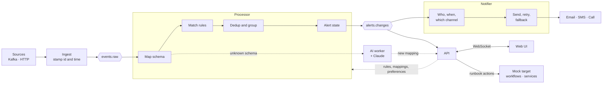

# Flexible Alerting & Notification Service

Takes errors, metric alerts and business events from any system, in any format, and turns them into
one clear alert for the people who own the problem, on the channel each of them prefers. Every alert
comes with the team's runbook, filled in with values from the event, and the runbook's steps can be
run from the UI.

Built for Hackathon 2026 (Software Engineering track).

## What it does

- **Ingests from Kafka and HTTP webhooks.** No fixed event format: each schema gets a mapping to a
  common envelope. A schema we have never seen shows up at once as "unmapped"; an AI worker writes
  its mapping in the background, and the waiting events are then processed as normal ones.
- **Rules per team.** Filters on any field, including values inside the payload
  (`notional > 10000000`, `error.code in [TIMEOUT, REJECTED]`), combined with AND/OR. Each rule sets
  who is notified, on which channel, and how the alert looks. Rules change at runtime, no restart.
- **No floods.** The same error 500 times a minute is one alert with a counter. Alerts are grouped per
  rule window, and alerts caused by the same upstream failure are linked into one incident.
- **Delivery that survives failures.** Email, SMS, phone call and the UI. Personal preferences
  (critical → call + SMS, warning → email), working hours, escalation and digests. Sends are retried
  with backoff and fall back to another channel; nothing is lost when a channel is down.
- **Runbooks you can run.** Attach a runbook in any shape (YAML steps, Markdown, a wiki link, free
  text). It is converted once to a structured form, and its steps can be actions: retry a workflow,
  restart a service, call a webhook, escalate. Risky actions wait for a person to approve them. Every
  step is recorded on the alert's timeline.
- **Live UI.** A real-time feed per team, ack and resolve, rule and preference editors, and proposals
  the system makes from past incidents (a new runbook, a different severity) for the owner to accept.

## Architecture

Five services on one internal Kafka cluster and Redis, plus a mock target that runbook actions call.
Each service has its own Postgres and is the only one that touches it; data moves between services
only as Kafka records or REST calls.



| Service | Job |
|---|---|
| Ingest | Receives events (HTTP and the sources Kafka cluster), stamps an id and receive time, writes them to `events.raw`. Answers the sender only after Kafka has the event. |
| Processor | Applies the schema mapping, evaluates rules, deduplicates and groups, links incidents. Owns alert state and auto-resolves alerts that went quiet. |
| Notifier | Decides who is told, when and on which channel; sends with retries and fallback; runs escalations and digests. |
| API | REST and WebSocket for the UI. Owns all configuration (rules, mappings, teams, preferences, runbooks) and the alert timeline; runs runbook actions behind an approval gate. |
| AI worker | Off the event path. Writes mappings for new schemas, converts uploaded runbooks, proposes runbooks from resolved incidents. Every result is checked by code before it is saved. |
| Mock target | Stands in for the systems runbook actions act on (workflow engine, services, ticketing, escalation). Answers any call and logs it; a repeated `Idempotency-Key` gets the first answer again, and `POST /_fail` makes the next calls fail. A real system replaces it with one action-target config change, no code. |

There is no LLM call per event: Claude is used once per new schema and once per runbook, so the event
path runs at Kafka speed. Every service is stateless and runs in several replicas; Kafka partitions
are the unit of scale.

## Run it

You need Docker with Compose v2.

```bash
unzip alerting.zip && cd alerting
cp .env.example .env          # optional: put your ANTHROPIC_API_KEY here
docker compose up -d --build  # first build takes a few minutes
```

Without an Anthropic key everything works except mapping unseen schemas and converting runbooks.

Then play the demo, a scripted bad morning at a fictional bank (about 3.5 minutes,
[story](data/README.md)):

```bash
docker compose run --rm simulator run demo
```

| Open | What you see |
|---|---|
| http://localhost:3000 | The UI: pick a user at the top, watch the live feed |
| http://localhost:8025 | Emails (MailHog) |
| http://localhost:8002 | SMS and phone calls the mock gateway received |
| http://localhost:8003/_calls | Runbook actions the mock target received |
| http://localhost:8000/swagger | API |
| http://localhost:8001/swagger | Ingest: send your own event with `POST /ingest/{source_id}` |

Stop with `docker compose down`; add `-v` to delete all data.

### Send your own event

```bash
curl -X POST http://localhost:8001/ingest/alertmanager-http \
  -d '{"alertname":"HighErrorRate","labels":{"service":"payments-api","severity":"critical"},
       "annotations":{"summary":"Error rate 12%"},"status":"firing"}'
```

Any JSON works. An unknown shape appears in the UI as unmapped and gets a mapping within about
15 seconds (needs the Anthropic key).

## Measured performance

Two runs on 21-11 (one Mac, Apple Silicon, every service in Docker Desktop, so all clocks are the same clock).
Background load from the sources simulator for 120 s (90% Kafka, 10% HTTP), plus 100 probe events over HTTP, each
opening its own alert routed to UI, email and SMS. Full reports:
[3,000 msg/s](docs/evaluation/20261121065848.md), [9,000 msg/s](docs/evaluation/20261121070611.md),
[9,000 msg/s with 3 processors and 3 notifiers](docs/evaluation/20261121071509.md) (`docker compose up -d --scale processor=3 --scale notifier=3`).

| Metric | 3,000 msg/s asked | 9,000 msg/s asked | 9,000 msg/s asked, 3 processors + 3 notifiers |
|---|---|---|---|
| Sent by the simulator / failed | 354,780 / 0 | 1,011,682 / 0 (3 processes, about 8,200 msg/s: the generator on the same machine is the limit) | 897,276 / 0 (about 6,850 msg/s: the extra containers took CPU from the generator) |
| Ingested (`events.raw`), sustained | 2,955 events/s | 7,991 events/s | 6,426 events/s |
| Processed (rules, dedup, alert state), sustained | 2,955 events/s | 7,991 events/s | 6,426 events/s |
| Processor lag at the end of the load / time to drain | 27 events / 1.0 s | 0 events / 0.5 s | 0 events / 0.7 s |
| Probes lost | 0 of 100 | 0 of 100 | 0 of 100 |
| Ingest → alert visible in the UI (WebSocket), p50 / p95 / p99 | 82 / 133 / 150 ms | 93 / 296 / 463 ms | 94 / 217 / 249 ms |
| Ingest → email sent (MailHog), p50 / p95 / p99 | 84 / 138 / 159 ms | 96 / 298 / 466 ms | 99 / 236 / 293 ms |
| Ingest → SMS sent (mock gateway), p50 / p95 / p99 | 87 / 135 / 154 ms | 96 / 298 / 464 ms | 101 / 230 / 257 ms |

The processor kept up with everything that was sent in every run (no lag left), so the ceiling is above 8,000
events/s on this machine; a second load machine is needed to find it. Three processor replicas (two of the six
`events.raw` partitions each) and three notifiers cut the tail: ingest → UI p99 from 463 to 249 ms. Ingest stays one
instance: it is bound to host port 8001. Background events deduplicate into alerts that
are already open, so they open no new alerts.

The judges of the AI worker (TypeSafe Jev), on labelled cases (labels written with AI help, not yet reviewed):

| Judge | Right | Dangerous misses |
|---|---|---|
| Run risk check (`auto` run starts by itself or waits for a person) | 25 of 30 (83%) | 0 (no risky run cleared) |
| Run start mode proposal (`auto` / `approval`) | 15 of 16 (94%) | 0 (no `auto` proposed where it should not be) |
| Rule severity proposal (lowers noisy rules, raises ones people rush to) | 16 of 20 (80%), the same on 3 repeats | 0 (never proposed a lower severity than it should) |

Reproduce, with the stack up: `bash data/simulator/check.sh` once, then
`set -a; . backend/ai-worker/.env; set +a; uv run scripts/evaluate.py --rate 9000 --duration 120 --probes 100`
(`--skip-jev` without a TypeSafe key). It writes `docs/evaluation/<time>.md` and `.json`.

## What is mocked

| Real thing | Here |
|---|---|
| Email provider | MailHog |
| SMS and phone provider | A gateway that logs each delivery with a timestamp |
| Systems runbook actions act on | The mock target (`backend/mock-target`): logs every call, can be told to fail |
| Event sources | A simulator that sends the brief's sample events over Kafka and HTTP |
| Login | None: the UI has a user picker |

A real provider replaces a mock by implementing one channel adapter in the Notifier.

## Repository

| Folder | Contents |
|---|---|
| `backend/ingest`, `processor`, `notifier`, `api`, `ai-worker` | The five services, each with its own README |
| `backend/mock-target` | The mock system runbook actions call |
| `backend/kafka` | The internal Kafka cluster and its topics |
| `frontend/` | Web UI |
| `data/` | Sources Kafka cluster and the event simulator |
| `contracts/` | Interfaces between services |
| `presentation/` | Slides and demo material |
